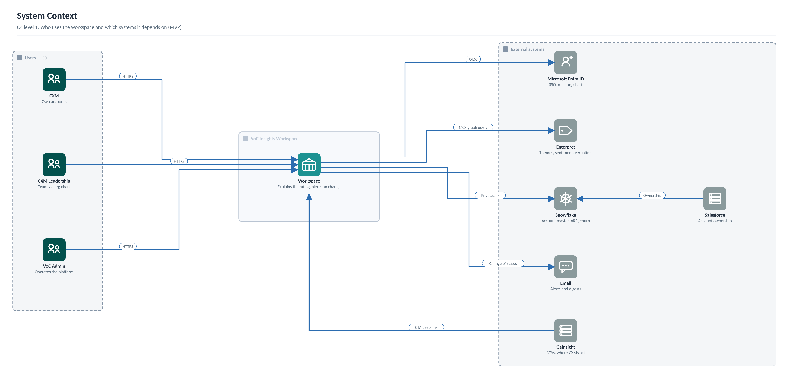
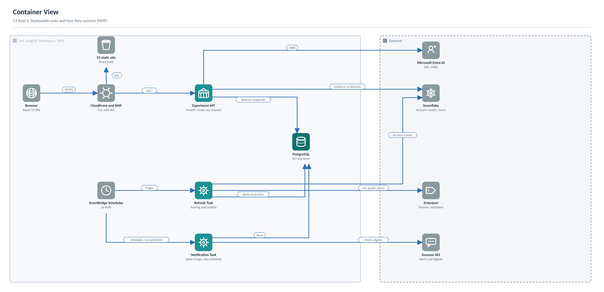
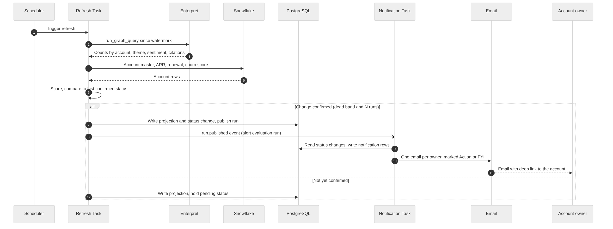
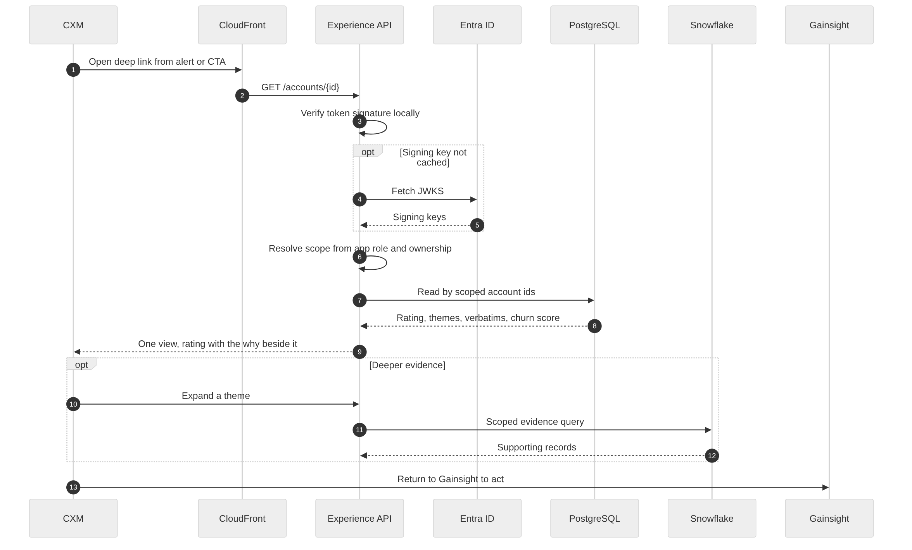

> Design v0.3, 16 November 2026. Where this file and `docs/01-product/requirements.md` differ, the requirements file wins: it reflects the latest prototype of 19 November 2026. Known differences are listed in `docs/01-product/open-items.md`. One naming change since v0.3: the "refresh task" described here is now two units, the ingestion task (ECS Fargate) and the Account Scoring Agent (AgentCore Runtime); see `overview.md`.

# VoC Insights Workspace: High Level Design (MVP)

| | |
|---|---|
| Version | 0.3, draft for NAVEX review. Adds the knowledge hub upload and approval cycle, and splits background work into a refresh task and a notification task |
| Date | 16 November 2026 |
| Scope | MVP, live 8 December 2026 |
| Inputs | FRD v1.0 (11 November 2026), NAVEX mock-up feedback (Lindsay, Anirudh, Angie), Discovery Closure deck |
| Structure | arc42, with C4 diagrams for context and containers |

This is an indicative design. Values marked *to confirm* are decided with NAVEX during build week one.

---

## 1. Goals

The MVP rebuilds the current At-Risk Account Scorecard as a stable, regularly refreshed platform with alerts. It is a rebuild for parity, not a redesign.

**Definition of done, as NAVEX stated it**

1. Parity with the current report in content, logic and single-view layout
2. Stable scheduled refresh
3. Change-of-status email alerts
4. SSO-based access
5. Gainsight linkage: a CTA opens the account directly, already signed in

**Quality goals, in priority order**

| Priority | Goal | What it means in the design |
|---|---|---|
| 1 | Explainability | The rating and its themes and verbatims sit together, in one view |
| 2 | Access correctness | A user can only ever retrieve accounts in their scope, enforced in the back end |
| 3 | Reliability | A failed refresh never removes good data; users always see the last good run |

---

## 2. Scope baseline after customer feedback

The FRD predates the mock-up review. The design follows the feedback where they differ, and the FRD should be updated to match.

| Area | FRD v1.0 | Design baseline | FRD references |
|---|---|---|---|
| Layout | Separate dashboard, accounts, verbatim, weekly changes pages | **One view**: tiles, accounts table with theme chips and verbatim, detail panel | FR-DSH, FR-ACC, FR-VRB, FR-WCH |
| Landing tiles | Impacted ARR, next renewal date, 9 week trend line | Red and Yellow counts, **Red ARR and Yellow ARR**, **New Red and New Yellow this week**, week-over-week clustered bar by volume and by ARR | FR-DSH-02, FR-DSH-03 |
| Themes | One main theme per account | **Multiple Enterpret theme chips** per account, straight from the taxonomy | FR-ACC-01, FR-ACC-05 |
| Filters | Includes renewal quarter, High ARR only, next meeting | Removed. Rule-based renewal window filter if needed. Team and CXM filters hidden for the CXM role | FR-ACC-04, FR-ACC-07, FR-SET-02 |
| Export | Excel or CSV, to be confirmed | **Excel** download of the filtered table | FR-RPT-03 |
| CXM commentary | Add, view, store, response tracking | **Removed for MVP**. Any future version writes straight to Gainsight | FR-ADT-05 to 08, FR-BKE-05 |
| User management | Deactivate, reactivate | **Removed**. SSO and the org chart are the only source | FR-RAC-03, FR-RAC-04, FR-LOG-03 |
| Knowledge hub | All three roles | **Removed from the CXM view**. CXM leadership uploads; VoC admins run the approval cycle. Phase *to confirm* against the scope workbook | FR-KHV, FR-LKN, FR-KHM |
| Roles | CXM, CXM leadership, VoC admin | Same three, plus an **ELT all-access viewer** and **AE and AE leadership by ownership**, with further levels added as configuration | FR-LOG-02, FR-RAC-02 |
| Churn score | Not in FRD | **Shown beside the VoC rating**, labelled as two distinct measures with an information tooltip each | New |
| Usage and audit | By segment and user | **Reportable along the org chart**: individual, team, segment, region | FR-USG-02, FR-USG-05 |
| Parity items | Not listed | Fired rule, confidence, exec sponsor, AE, ARR tier, super product family, issue status and churn-language flag | Current scorecard |

**One consequence needs a NAVEX decision.** The FRD defines a CXM "response" to a red account as commentary added in the application (FR-ADT-06). With commentary removed, response tracking in the manager summary, the response window setting and the red account responses panel have no data source (FR-MSM-02, 03, 05, 06, FR-SET-01, FR-USG-03). The options are to drop response tracking from the MVP, or to source responses from Gainsight CTA activity, which is a Phase 1 integration. The design assumes the first until NAVEX decides.

---

## 3. Constraints

| Constraint | Source |
|---|---|
| Parity first; no net-new features without NAVEX sign-off | Customer feedback |
| Sign-in only through NAVEX SSO; no local passwords | NFR-01 |
| Snowflake stays the system of record; Enterpret keeps classifying | NFR-03, closure deck |
| AI only from approved sources and services approved by NAVEX security | NFR-04 |
| Email through a NAVEX-approved service | NFR-14 |
| Scoring rules, thresholds and response settings configurable without code changes | NFR-16 |
| AWS hosting; React front end; Python back end | Engagement decisions |
| CXMs do their work in Gainsight and Salesforce, not here | Customer feedback |

---

## 4. Context

| External system | Direction | What crosses the boundary | Protocol |
|---|---|---|---|
| Microsoft Entra ID | Out | Sign-in, signing keys, app roles, manager attribute | OIDC, HTTPS |
| Enterpret | Out | Theme counts, sentiment, verbatims with citations | MCP graph queries, HTTPS |
| Snowflake | Out | Account master, ARR, renewal date, owners, churn score; evidence on demand | PrivateLink, TLS |
| Gainsight | In | CTA deep link opens the account | HTTPS |
| Salesforce | Indirect | Account ownership, via Snowflake | Existing ETL |
| Email service | Out | Change-of-status alerts and digests | SMTP or SES API |

---

## 5. Solution strategy

| Decision | Reason |
|---|---|
| Precompute a **serving projection** at each refresh and read from it | Pages respond in seconds and Snowflake suspends between runs |
| Bind the **access scope into every query** | A user cannot retrieve an out-of-scope account, whatever the UI does |
| **Publish a run by pointer swap**, only after it completes | Users always see the last good run; a failed run changes nothing |
| **Decouple alerting from refresh**, with confirmation and a dead band | Fresh data three times a day without alerting on accounts that flip back and forth |
| **Aggregate in Enterpret** with graph queries | A refresh is a handful of calls, not one per account |
| **Regenerate narratives only when inputs change** | Inference cost tracks change, not refresh frequency |
| **No data entry in the platform**; downstream actions write to Gainsight or Salesforce | Matches how CXMs work and avoids a third place to record |

---

## 6. Building blocks

| Container | Responsibility | Technology |
|---|---|---|
| Single page application | One-view workspace, role-aware navigation, MSAL sign-in | React 19, TypeScript, TanStack Query and Table |
| CloudFront and WAF | TLS, web ACL, static hosting, routing `/api/*` | AWS |
| Experience API | Token validation, scope resolution, reads, export, brief, admin | Python 3.13, FastAPI, Pydantic v2, SQLAlchemy |
| Refresh task | Pull, match, score, theme ranking, status confirmation, publish | Python on ECS Fargate Spot, EventBridge Scheduler, three runs a day |
| Notification task | Change-of-status alerts, digests, knowledge hub decision emails | Same container image, separate Fargate task and role; EventBridge rule and schedules; Amazon SES |
| Serving store | Projection, status state, saved views, audit, run history, knowledge hub records | PostgreSQL |
| Document store | Knowledge hub files in quarantine, review and published prefixes; presigned upload and download; malware scan | S3, GuardDuty Malware Protection, EventBridge |
| Secrets | Snowflake key pair, Enterpret token, email credentials | AWS Secrets Manager |

---

## 7. Runtime views

### 7.1 Refresh, scoring and change-of-status alert

A scheduled run pulls the account master from Snowflake and theme aggregates from Enterpret, scores each account with NAVEX's versioned rule set, and compares the result with the last *confirmed* status. A change becomes confirmed only once it holds across the agreed number of runs and clears the dead band around the threshold. Confirmed changes raise an event; the alert evaluation sends one email per owner, marked **Action** for a worsening status and **FYI** for an improvement.

### 7.2 Opening an account from an alert or Gainsight CTA

The link carries the Salesforce account identifier. If the user is not signed in, sign-in preserves the target and returns them to it. The API resolves scope from the app role and ownership, reads the account from the published run, and returns rating, themes, verbatims and churn score together. An account outside the user's scope returns *not available*, without revealing whether it exists.

### 7.3 Other flows

| Flow | Summary |
|---|---|
| Sign-in | MSAL authorization code with PKCE; landing page by role; sign-ins logged |
| Excel export | Same filters and scope as the table; file states user, time and filters |
| Account brief | Generated from approved sources at refresh; served from the projection |
| Scheduled digest | Admin-defined templates; CXMs set light personal preferences; sent by the notification task |
| Failed refresh | Retried with backoff; last good run stays published; VoC admins alerted |
| Knowledge hub upload and approval | Leadership or admin uploads straight to S3 through a presigned URL; the file is scanned and checked, then waits in the admin queue; approve publishes it, decline returns it with a reason; the uploader is notified and every step is audited (LLD 2.4, 5.6) |

---

## 8. Deployment

AWS, single region matched to NAVEX's Snowflake region. See the MVP Infrastructure Architecture diagram in the closure deck: CloudFront and WAF at the edge, an internet gateway and load balancer in public subnets, the API, the refresh task and the notification task on ECS Fargate in private subnets, Amazon SES for email, PostgreSQL on RDS, Snowflake over PrivateLink, outbound calls to Enterpret and Entra through a NAT gateway. Environments: development, test and production, with non-production sharing network components.

---

## 9. Cross-cutting concepts

| Concept | Approach |
|---|---|
| Authentication | Entra ID, OIDC. Token signature verified locally against cached signing keys |
| Authorisation | App roles in Entra. Scope resolved per request from role and ownership, cached briefly, bound into every query |
| Privacy | Verbatims masked at ingest; only theme-driving excerpts stored; raw records stay in source systems |
| Observability | OpenTelemetry instrumentation exported to Dynatrace; CloudWatch for AWS service alarms |
| Audit | Every sign-in, export, digest change and admin action, with user, time and org position |
| Configuration | Rule set version, confirmation runs, dead band, cool-down, digest templates held as data |
| Resilience | Run-level idempotency, retries with backoff, pointer-swap publication |

---

## 10. Architecture decisions

| ID | Decision |
|---|---|
| ADR-01 | PostgreSQL as the serving store, for portability and SQL filtering |
| ADR-02 | Access scope enforced in the repository layer on every read |
| ADR-03 | A run is published by pointer swap only after it completes |
| ADR-04 | Alert evaluation runs on its own schedule, with confirmation and dead band |
| ADR-05 | Enterpret accessed through MCP graph queries with a service token |
| ADR-06 | Deep evidence fetched from Snowflake on demand, scoped |
| ADR-07 | No in-application data entry for the MVP |
| ADR-08 | One-view UI composed from summary, trend and accounts endpoints |

---

## 11. Quality requirements

| NFR | Design response |
|---|---|
| NFR-02 Authorisation | ADR-02; automated tests prove a CXM cannot retrieve another owner's account |
| NFR-05 Freshness | Three runs a day supported; last refresh time on every page |
| NFR-06 Reliability | ADR-03; failed runs alert admins |
| NFR-07 Performance | Reads from the projection with indexes on filter columns; target 3 seconds for typical views, *to confirm* |
| NFR-09 Scalability | Stateless API scales horizontally; access model extends by configuration |
| NFR-10 Auditability | Audit table, retention *to confirm* |
| NFR-12 Accessibility | WCAG 2.1 AA target, *to confirm* |

---

## 12. Risks and open decisions

| # | Item | Owner |
|---|---|---|
| 1 | Response tracking without in-app commentary: drop for MVP, or source from Gainsight | NAVEX |
| 2 | Current scoring rule set and parity reference handed over, so parity can be tested | NAVEX VoC team |
| 3 | Primary theme rule for the single-value views: highest volume or highest negative volume | NAVEX |
| 4 | Org chart source and refresh cadence; Salesforce field defining AE ownership | NAVEX IT |
| 5 | Entra app registration with app roles, and admin consent | NAVEX IT |
| 6 | Enterpret request limits; measured with the probe, confirmed with Enterpret | Psiog, Enterpret |
| 7 | Churn score definitions for the tooltips | NAVEX |
| 8 | Verbatim masking rules | NAVEX |
| 9 | Gainsight CTA link format agreed with Angie | NAVEX, Psiog |
| 10 | Snowflake region and edition, which fix the AWS region and PrivateLink | NAVEX IT |
| 11 | Knowledge hub in the MVP: the scope workbook lists contributions beyond admins as late Phase 1. Confirm the phase, document types and retention | NAVEX |

---

## Glossary

| Term | Meaning |
|---|---|
| Projection | The precomputed, read-optimised copy of each run's results |
| Scope | The set of accounts a person may see, from role and ownership |
| Confirmed status | The last status that held long enough to alert on |
| Dead band | The gap between the threshold to enter a status and the threshold to leave it |
| Run | One scheduled refresh, published only if it completes |
