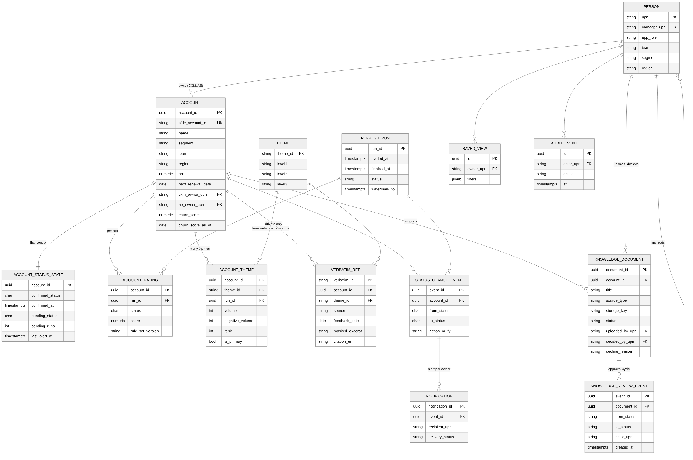

> Design v0.3, 16 November 2026. Where this file and `docs/01-product/requirements.md` differ, the requirements file wins: it reflects the latest prototype of 19 November 2026. Known differences are listed in `docs/01-product/open-items.md`. One naming change since v0.3: the "refresh task" described here is now two units, the ingestion task (ECS Fargate) and the Account Scoring Agent (AgentCore Runtime); see `overview.md`.

# VoC Insights Workspace: Low Level Design (MVP)

| | |
|---|---|
| Version | 0.3, draft for NAVEX review. Adds the knowledge hub upload and approval cycle, and splits background work into a refresh task and a notification task |
| Date | 16 November 2026 |
| Companion to | High Level Design v0.3 |
| Structure | IEEE 1016 software design description, reduced to what the MVP needs |

---

## 1. Introduction

This document specifies the components, data, interfaces and algorithms for the MVP flows in the High Level Design. It is detailed enough to build and test against, and it traces to the FRD requirement identifiers. Items marked *to confirm* are agreed with NAVEX in build week one.

---

## 2. Component design

### 2.1 Single page application

| Module | Responsibility |
|---|---|
| `auth` | MSAL sign-in with authorization code and PKCE; preserves the deep-link target through sign-in |
| `workspace` | The one view: summary tiles, week-over-week chart, accounts table, account detail panel |
| `accounts-table` | TanStack Table; server-side filtering, sorting and paging; theme chips; inline verbatim |
| `account-detail` | Full theme list, driver verbatims, churn score beside the VoC rating with tooltips, account brief |
| `saved-views` | Create, apply, rename, delete |
| `digest-preferences` | Light personal digest settings, as a tab |
| `knowledge-hub` | Leadership: upload, own uploads with approval status, published files. Admin: approval queue, approve or decline with a reason, upload |
| `admin` | Refresh runs, source health, digests, usage and audit, read-only access list |

Role-aware rendering is presentational only. The API never relies on the UI hiding something.

| Element | CXM | CXM leadership | ELT viewer | VoC admin |
|---|---|---|---|---|
| Team and CXM filters | Hidden | Shown | Shown | Shown |
| Week-over-week chart | Own accounts | Team | All | All |
| Admin section | Hidden | Hidden | Hidden | Shown |
| Knowledge hub | Hidden | Upload, own uploads, published files | Hidden | Approval queue and upload |

### 2.2 Experience API

Layered as ports and adapters, so the data platform stays replaceable.

| Layer | Contents |
|---|---|
| `api` | FastAPI routers, request and response models, error mapping |
| `security` | JWT verification, scope resolution middleware, audit hook |
| `application` | Use cases: list accounts, get account, export, brief, saved views, admin queries, knowledge hub upload and review |
| `domain` | Rating, theme ranking, status confirmation, scope rules, document approval state machine. No I/O |
| `adapters` | PostgreSQL repositories, Snowflake evidence adapter, Enterpret adapter, email adapter, document store adapter (S3) |

Every repository method takes an `AccessScope` as its first argument. A method without one does not compile against the port.

### 2.3 Background tasks

Background work runs as two ECS Fargate tasks built from one container image and started with different commands. They share the domain and adapter code, and each has its own task role, schedule, logs and alarms.

| Task | Trigger | Does | Permissions |
|---|---|---|---|
| Refresh task | EventBridge Scheduler, three runs a day (*to confirm* against cost) | Pull, match, score, rank themes, confirm status, explain, publish | Snowflake, Enterpret, Bedrock, serving store read and write |
| Notification task | EventBridge rule on `run.published` for the alert evaluation run; EventBridge Scheduler for each digest; `knowledge.decided` events | Change-of-status alerts, digests, knowledge hub decision emails | Serving store read, notification status write, Amazon SES send |

The split keeps a mail delivery problem from failing a scoring run, and keeps sends out of anything that is retried as a whole. The refresh task is safe to rerun. The notification task is idempotent per `notification_id`: a notification row is written before sending, and a retry skips rows already marked sent.

**Refresh task.** One idempotent pipeline per run. Each stage writes to a run-scoped staging area; nothing is visible to readers until publication.

| Stage | Action | Failure behaviour |
|---|---|---|
| 1 Start | Create `refresh_run`, take an advisory lock so runs never overlap | Exit if a run is already active |
| 2 Accounts | Pull the account master from Snowflake | Retry three times with backoff, then fail the run |
| 3 Feedback | `run_graph_query` for theme and sentiment counts per account over the scoring window | Retry; fail the run on persistent error |
| 4 Verbatims | Fetch new driver verbatims since the watermark; mask at ingest | Non-fatal: keep the previous set |
| 5 Match | Join feedback to accounts on the Salesforce account identifier; hold unmatched records | Counted and reported (FR-SRC-02) |
| 6 Score | Apply NAVEX's versioned rule set; record fired rule, confidence, signals | Fail the run on rule error |
| 7 Rank themes | Rank per account; mark the primary theme | Deterministic |
| 8 Confirm status | Apply the confirmation algorithm in section 5.2 | Deterministic |
| 9 Explain | Generate explanations and briefs only where the input hash changed | Non-fatal: page states the explanation is unavailable |
| 10 Publish | Swap `published_run` to this run in one transaction | Atomic; on failure the previous run stays published |
| 11 Finish | Close the run, emit `run.published` with the run id and whether it is the alert evaluation run, emit metrics, notify admins on failure | |

**Notification task.**

| Job | Input | Action | Failure behaviour |
|---|---|---|---|
| Alerts | `run.published` for the alert evaluation run | Read that run's `status_change_event` rows; write one `notification` per owner; send one batched email per owner, marked Action needed or FYI | Retry delivery with backoff; unsent rows are picked up on the next start |
| Digests | Schedule per `digest_template` | Build each recipient's digest from the published run within their scope and preferences; send | A failed recipient does not block the others |
| Knowledge hub decisions | `knowledge.decided` | Email the uploader the decision, marked FYI | Retry delivery |

### 2.4 Knowledge hub upload and approval

The browser uploads straight to the document store; the API never handles file bytes.

| Step | Actor | Action | Failure behaviour |
|---|---|---|---|
| 1 Request upload | Leadership or admin | `POST /knowledge-hub/uploads` validates type, size, and that the account is in the caller's scope; creates the record as `UPLOADING`; returns a presigned PUT URL valid for 10 minutes | `400` unsupported type or size; `404` account outside scope |
| 2 Upload | Browser | PUT to the quarantine prefix in S3 | URL expires; record is cleaned up after 24 hours |
| 3 Complete | Browser | `POST /knowledge-hub/files/{id}/complete`; status becomes `CHECKING` | Idempotent |
| 4 File checks | System | GuardDuty Malware Protection for S3 scans the object; an EventBridge rule passes the result to the Experience API, which also verifies the file signature against the declared type | Threat found or mismatch: `REJECTED_BY_CHECK`, object deleted, uploader notified |
| 5 Queue | System | Clean file moves to the review prefix; status `AWAITING_APPROVAL`; VoC admins see it in the queue | |
| 6 Decide | VoC admin | Approve: status `PUBLISHED`, object moves to the published prefix. Decline: status `DECLINED` with a reason | An admin cannot approve a file they uploaded when another admin exists, *to confirm* |
| 7 Notify | System | Uploader receives an email with the decision, marked FYI | Retry delivery; record status |

Every step writes an `audit_event` and a `knowledge_review_event`. Downloads are served through short-lived presigned GET URLs after a scope check on the linked account. Published files are stored only; the MVP does not index them for search or feed them to the model. Using approved files as evidence is a Phase 1 capability.

---

## 3. Data design

### 3.1 Entity relationships



### 3.2 Data dictionary

**account** *(one row per in-scope account, refreshed each run)*

| Column | Type | Notes |
|---|---|---|
| account_id | uuid PK | Internal key |
| sfdc_account_id | text, unique | Join key across Snowflake, Enterpret and Gainsight; used in deep links |
| name, segment, team, region | text | From the account master |
| arr, arr_tier | numeric, text | ARR tier is a parity filter |
| next_renewal_date | date | Single date; feeds the rule-based renewal window filter |
| cxm_owner_upn, ae_owner_upn | text | Ownership for scope resolution |
| exec_sponsor | text | Parity field |
| super_product_family, product_domains | text, text[] | Product placement at account level |
| churn_score, churn_score_as_of | numeric, date | Read from Snowflake; shown beside, never blended with, the VoC rating |

**account_rating** *(one row per account per run)*

| Column | Type | Notes |
|---|---|---|
| account_id, run_id | uuid | Composite key |
| status | char | R, Y, G, or Gray when feedback is insufficient, *to confirm* |
| score | numeric | Friction score from the rule set |
| fired_rule, confidence | text, text | Parity: which rule produced the rating, and how confident |
| signals | jsonb | Churn-language flag, issue status and other rule inputs |
| rule_set_version | text | Every rating is reproducible against its rule version |

**account_theme** *(many themes per account)*

| Column | Type | Notes |
|---|---|---|
| account_id, theme_id, run_id | | Composite key |
| volume, negative_volume | int | From Enterpret aggregates |
| rank | int | Order of chips in the table |
| is_primary | bool | One per account; rule *to confirm* |

**theme**: `theme_id`, `level1`, `level2`, `level3`, straight from the Enterpret taxonomy, with no custom layer.

**verbatim_ref**: `verbatim_id`, `account_id`, `theme_id`, `source`, `feedback_date`, `masked_excerpt`, `citation_url`. Only verbatims that drive a theme are stored.

**account_status_state**: `account_id`, `confirmed_status`, `confirmed_at`, `pending_status`, `pending_runs`, `last_alert_at`. The memory that prevents flapping alerts.

**status_change_event**: `event_id`, `account_id`, `run_id`, `from_status`, `to_status`, `action_or_fyi`, `created_at`.

**notification**: `notification_id`, `event_id`, `recipient_upn`, `channel`, `sent_at`, `delivery_status`.

**weekly_snapshot**: `week_start`, `account_id`, `status`, `arr`. Source for New Red, New Yellow, Repeat Red, Improved, Worsened, and the week-over-week chart.

**person**: `upn`, `manager_upn`, `app_role`, `team`, `segment`, `region`, synced from Entra and the org chart.

**role_policy**: `app_role`, `scope_strategy`, `ownership_field`, `features`. Adding an access level is a new row.

**knowledge_document** *(one row per uploaded file)*

| Column | Type | Notes |
|---|---|---|
| document_id | uuid PK | |
| title, source_type | text | Source type: interview notes, Customer Advisory Board notes, user-group findings |
| account_id | uuid FK | The account the file supports; drives who can see it |
| product_domain | text, nullable | Optional tag |
| file_name, content_type, size_bytes, sha256 | text, text, bigint, text | Captured at upload; hash detects duplicates |
| storage_key | text | Current S3 key: quarantine, review or published prefix |
| status | text | `UPLOADING`, `CHECKING`, `REJECTED_BY_CHECK`, `AWAITING_APPROVAL`, `PUBLISHED`, `DECLINED`, `WITHDRAWN` |
| uploaded_by_upn, uploaded_at | text, timestamptz | |
| decided_by_upn, decided_at, decline_reason | text, timestamptz, text | Set on approve or decline |

**knowledge_review_event**: `event_id`, `document_id`, `from_status`, `to_status`, `actor_upn` (or `system`), `note`, `created_at`. The full history of each file through the cycle.

**saved_view**, **digest_template**, **digest_preference**, **audit_event**, **refresh_run**, **published_run**: as named.

### 3.3 Retention

| Data | Retention |
|---|---|
| Ratings, themes, status events | Weekly snapshots kept; intra-week runs kept 30 days, *to confirm* |
| Verbatim excerpts | Current run plus 30 days |
| Audit events | *To confirm* with NAVEX (NFR-10) |
| Digest archive | 30 days (FR-DIG-08) |
| Knowledge hub files | Published: kept until withdrawn. Declined or rejected by checks: deleted after 30 days. Period *to confirm* |

---

## 4. Interface design

### 4.1 REST API

All endpoints under `/api/v1`, JSON unless stated, bearer token required, scope applied to every read.

| Method and path | Roles | Purpose |
|---|---|---|
| `GET /me` | All | Profile, role, landing page, scope size |
| `GET /portfolio/summary` | All | Red and Yellow counts, Red ARR, Yellow ARR, New Red and New Yellow this week, last refresh time |
| `GET /portfolio/trend?weeks=12` | All | Week-over-week totals with percentage Red and Yellow, by account count and by ARR |
| `GET /accounts` | All | Filtered, sorted, paged list with theme chips and top driver verbatims |
| `GET /accounts/{sfdc_account_id}` | All | Full detail for the one-view panel and the deep link |
| `GET /accounts/export.xlsx` | All | Same filters and scope as the list; states user, time and filters |
| `GET /accounts/{id}/brief` | All | Account brief from the published run |
| `GET /verbatims` | All | Verbatim search within scope |
| `GET, POST, PATCH, DELETE /saved-views` | CXM, leadership | Saved views |
| `GET, PUT /me/digest-preferences` | CXM, leadership | Light personal digest settings |
| `POST /knowledge-hub/uploads` | Leadership, admin | Create the record and return a presigned upload URL |
| `POST /knowledge-hub/files/{id}/complete` | Uploader | Mark the upload finished and start file checks |
| `GET /knowledge-hub/files?mine=true&status=` | Leadership, admin | Own uploads with status; published files within scope |
| `GET /knowledge-hub/files/{id}/download` | Leadership, admin | Presigned download URL after a scope check |
| `DELETE /knowledge-hub/files/{id}` | Uploader, admin | Withdraw a file |
| `GET /admin/knowledge-hub/queue` | Admin | Files awaiting approval, oldest first |
| `POST /admin/knowledge-hub/files/{id}/approve` | Admin | Publish |
| `POST /admin/knowledge-hub/files/{id}/decline` | Admin | Decline with a required reason |
| `GET /admin/refresh-runs`, `GET /admin/source-health`, `POST /admin/source-health/check` | Admin | Operations |
| `GET, POST, PATCH /admin/digests`, `POST /admin/digests/{id}/preview, send, pause, resume` | Admin | Digest management; sends are queued for the notification task |
| `GET /admin/usage?group_by=person,team,segment,region` | Admin | Usage along the org chart |
| `GET /admin/audit`, `GET /admin/access` | Admin | Audit log, read-only access list |

**Accounts list filters**: `status`, `segment`, `team`, `cxm`, `region`, `arr_tier`, `product`, `super_product_family`, `theme`, `issue_status`, `churn_language`, `renewal_within_days`, `q`, `sort` (`arr_desc`, `renewal_asc`), `page`, `page_size`. Filters only ever narrow within scope.

**Errors**: `401` invalid token; `403` signed in without a mapped role; `404` account not found *or outside scope*, deliberately indistinguishable; `503` data source unavailable with the last good run still served where possible; `409` knowledge hub action that the file's current status does not allow; `413` or `415` file too large or of an unsupported type.

### 4.2 Enterpret

| Call | When | Purpose |
|---|---|---|
| `get_graph_schema`, `search_graph_fields` | Build time, then on change | Pin field names and the account identifier |
| `resolve_taxonomy_scope` | Daily | Cache the three-level taxonomy |
| `run_graph_query` | Each run | Theme and sentiment counts per account over the scoring window |
| `find_user_quote` | Each run, for changed themes | Driver verbatims with citations |

Bearer token from Secrets Manager. Request ceiling measured with the probe and confirmed with Enterpret.

### 4.3 Snowflake

Key-pair authentication over PrivateLink. One read of the account master per run, selecting only the columns in section 3.2. Evidence queries on demand are parameterised and carry the caller's scope.

### 4.4 Email

| Field | Content |
|---|---|
| Subject | `[Action needed]` or `[FYI]`, then the account count and the change |
| Body | Per account: name, previous and new status, top themes, ARR, renewal date, link |
| Batching | One email per owner per evaluation run |
| Link | `https://<host>/accounts/{sfdc_account_id}?src=alert&event={event_id}` |

### 4.5 Gainsight deep link

`https://<host>/accounts/{sfdc_account_id}?src=cta`, used in the VoC CTA template that Angie is building. The link format is the whole contract for the MVP; write-back is Phase 1.

---

## 5. Algorithms

### 5.1 Scope resolution

```
resolve_scope(user):
    policy = role_policy[user.app_role]          # no mapped role -> 403
    if policy.scope_strategy == ALL:
        return Scope.all(user)
    owners = {user.upn}
    if policy.scope_strategy == SUBTREE:
        owners |= descendants(user.upn)          # recursive on person.manager_upn
    ids = accounts where <policy.ownership_field> in owners
    return Scope(user, ids)                      # cached 10 minutes per user
```

| App role | Strategy | Ownership field | MVP |
|---|---|---|---|
| VoC.CXM | Own | cxm_owner_upn | Yes |
| VoC.CXMLeader | Subtree | cxm_owner_upn | Yes |
| VoC.Admin | All | | Yes |
| VoC.ELTViewer | All, read only | | Yes |
| VoC.AE | Own | ae_owner_upn | Yes, field *to confirm* |
| VoC.AELeader | Subtree | ae_owner_upn | Yes, field *to confirm* |
| Product and other functions | Defined later | | Configuration only |

### 5.2 Status confirmation

```
for account in run:
    s = state[account]
    new = rating(account).status
    if not clears_dead_band(account, s.confirmed_status, new):
        new = s.confirmed_status                 # inside the band: no change
    if new == s.confirmed_status:
        s.pending_status, s.pending_runs = None, 0
        continue
    if new == s.pending_status:
        s.pending_runs += 1
    else:
        s.pending_status, s.pending_runs = new, 1
    if s.pending_runs >= CONFIRM_RUNS:
        raise StatusChangeEvent(account, s.confirmed_status, new,
                                ACTION if worse(new, s.confirmed_status) else FYI)
        s.confirmed_status, s.pending_status, s.pending_runs = new, None, 0
```

`CONFIRM_RUNS`, the dead band width and the per-account alert cool-down are configuration, *to confirm*. Alerts are sent once per evaluation run, not once per refresh.

### 5.3 Weekly comparison

At the weekly cut-off, write `weekly_snapshot`. Compare with the previous week: **New Red** (not red last week, red now), **New Yellow**, **Repeat Red** (red both weeks), **Improved** and **Worsened**. The week-over-week chart reads the last twelve snapshots.

### 5.4 Theme ranking and primary theme

Rank an account's themes by negative volume, then total volume. The primary theme is rank one. Whether negative or total volume leads is the open decision in HLD section 12.

### 5.5 Driver verbatims

For each of an account's top three themes, keep the most recent negative verbatims up to a small fixed count, so the supporting feedback list shows only what drives the analysis, as NAVEX asked.

### 5.6 Document approval state machine

```
UPLOADING --complete--> CHECKING --clean--> AWAITING_APPROVAL --approve--> PUBLISHED
                           |                        |                          |
                           +--threat or mismatch--> REJECTED_BY_CHECK          +--withdraw--> WITHDRAWN
                                                    +--decline (reason)--> DECLINED
```

Transitions are enforced in the domain layer; any other transition returns `409`. `approve` and `decline` require the VoC.Admin role. `withdraw` is allowed for the uploader or an admin. A declined file is not edited in place: the uploader corrects it and uploads again, which creates a new record.

Visibility: a CXM leader sees their own uploads in any status, and published files whose account is inside their scope. An admin sees everything. CXM, ELT viewer and AE roles have no knowledge hub access in the MVP.

---

## 6. Human interface design

**The one view**

| Region | Content |
|---|---|
| Header | Last refresh time, saved views, Excel download |
| Tiles | Red count, Yellow count, Red ARR, Yellow ARR, New Red this week, New Yellow this week |
| Chart | Week-over-week clustered bar of total ARR with percentage Red and Yellow, by count and by ARR |
| Filters | Rating, segment, ARR tier, region, product, super product family, theme, issue status, renewal window; team and CXM for leadership and above |
| Table | Account, rating with fired rule and confidence, theme chips, top verbatim, ARR, next renewal date, owner, exec sponsor |
| Detail panel | Rating and churn score side by side with tooltips, full themes, driver verbatims, account brief |

**Knowledge hub**

| Screen | Role | Content |
|---|---|---|
| Knowledge hub | CXM leadership | Upload form (title, account, source type, optional product domain); own uploads with the cycle shown as Uploaded, File checks, Awaiting approval, Published or Declined with the reason; published files |
| Knowledge hub | VoC admin | Approval queue with Approve and Decline, decline reason required; upload form |

A full copy and grammar pass is part of the UI acceptance.

---

## 7. Configuration

| Setting | Where |
|---|---|
| Rule set version | Deployed by NAVEX, tested before release (FR-BKE-02) |
| Refresh schedule and alert evaluation time | Admin setting |
| Confirmation runs, dead band, cool-down | Admin setting |
| Digest templates and schedules | Admin, with prebuilt options |
| Role policies | Data, `role_policy` table |
| Knowledge hub file types and size limit | Admin setting; PDF, DOCX, CSV, XLSX, PPTX up to 25 MB by default (FR-KHM-05) |
| Knowledge hub decline reasons | Admin setting, with free text |

---

## 8. Requirements traceability

| FRD area | Status in this design | Component |
|---|---|---|
| FR-LOG-01, 02, 04, 05, 06 | Kept | SPA `auth`, API `security` |
| FR-LOG-03 | Removed with manual user management | |
| FR-DSH-01 to 06 | Changed: tiles and chart per feedback; next meeting removed | `workspace`, `/portfolio/*` |
| FR-ACC-01 to 08 | Changed: theme chips, inline verbatim, no renewal quarter or High ARR | `accounts-table`, `/accounts` |
| FR-ADT-01 to 04, 09 | Kept, with trimmed supporting feedback and churn score added | `account-detail` |
| FR-ADT-05 to 08 | Removed for MVP | |
| FR-SVW-01 to 04 | Kept | `saved-views` |
| FR-VRB-01 to 04 | Kept, inside the one view | `/verbatims` |
| FR-WCH-01, 02 | Kept as New Red and New Yellow tiles and the weekly comparison | Refresh task 5.3 |
| FR-WCH-03 | On hold pending NAVEX sign-off | |
| FR-RPT-01 to 04 | Kept as Excel download of the filtered table | `/accounts/export.xlsx` |
| FR-LHM, FR-LAC | Kept, inside the one view for leadership | `workspace` |
| FR-MSM-01, 04 | Kept | |
| FR-MSM-02, 03, 05, 06, FR-SET-01 | Pending the response tracking decision | |
| FR-CRP-01 to 04 | On hold pending NAVEX sign-off; saved views cover the need | |
| FR-KHV-01 to 03 | Removed: no knowledge hub in the CXM view | |
| FR-LKN-01 to 03 | Kept: leadership sees published files, uploads, and tracks approval status | `knowledge-hub`, `/knowledge-hub/*` |
| FR-KHM-01 to 07 | Kept: admin upload, file checks, queue, approve or decline, notify | `knowledge-hub`, `/admin/knowledge-hub/*`, section 2.4 |
| FR-DIG-01 to 08 | Kept, plus light personal preferences | Notification task, `/admin/digests` |
| FR-SRC-01 to 05 | Kept | `/admin/source-health` |
| FR-RAC-01, 02 | Kept as a read-only access list | `/admin/access` |
| FR-RAC-03 to 05 | Removed | |
| FR-USG-01, 02, 04, 05, 06 | Kept, grouped along the org chart | `/admin/usage` |
| FR-USG-03 | Pending the response tracking decision | |
| FR-SET-02 | Removed with the High ARR filter | |
| FR-BKE-01 to 04 | Kept | Refresh task |
| FR-BKE-06 | Kept | Notification task |
| FR-BKE-05 | Removed with commentary | |

---

## 9. Open items

The open decisions in HLD section 12 apply. Two are specific to this level of design: the exact Salesforce field for AE ownership, and whether Gray is a fourth rating returned by the current rule set.

Knowledge hub: NAVEX's scope workbook lists contributions beyond admins as late Phase 1, while this design places leadership upload in the MVP. NAVEX to confirm the phase, the eligible document types, the retention period, and whether an admin may approve their own upload.
