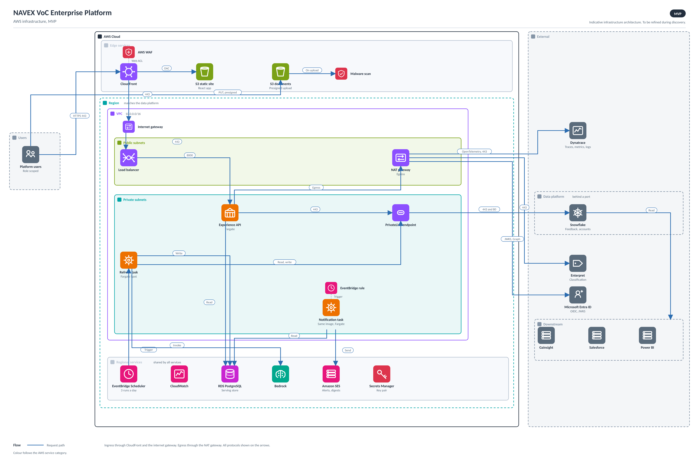

# Architecture overview

Short form of the design, mapped to this repository. Detail is in `hld.md` and `lld.md`.

## Components

| Component | Runs on | Technology | Code |
|---|---|---|---|
| Web app | S3 and CloudFront with WAF | React 19, TypeScript 5, Vite, Tailwind CSS, shadcn/ui, SCSS partials, TanStack Query and Table, MSAL | `apps/web` |
| Experience API | ECS Fargate behind the load balancer | Python 3.13, FastAPI, Pydantic v2, SQLAlchemy 2 async | `services/experience-api` |
| Ingestion task | ECS Fargate, started by EventBridge Scheduler | Python 3.13, Snowflake connector, MCP Python SDK | `services/ingestion` |
| Account Scoring Agent | Amazon Bedrock AgentCore Runtime | LangGraph, Jinja2 prompts, Pydantic structured output | `services/account-scoring-agent` |
| Notification task | ECS Fargate, started by EventBridge | Python 3.13, Jinja2 email templates | `services/notifications` |
| Serving store | Amazon RDS for PostgreSQL | One schema shared by the four services | `packages/voc-data` |
| Documents | S3 with GuardDuty Malware Protection | Presigned upload and download | `services/experience-api/app/ports/document_store.py` |
| Telemetry | Dynatrace through OpenTelemetry, with CloudWatch | Traces, metrics, JSON logs | `core/telemetry.py` in each service |



The diagram predates the split of the background work: where it shows one "Refresh Agent", read the ingestion task on ECS Fargate followed by the Account Scoring Agent on AgentCore Runtime.

## How a request flows

1. The browser signs in with Corp AD (Microsoft Entra ID) through MSAL and holds the access token in memory.
2. `lib/apiClient.ts` attaches the token to every call to `/api/v1`.
3. The API verifies the token against Entra's signing keys, resolves role, permissions and data scope once per request, and passes `CurrentUser` to the service function.
4. The service function binds the scope into its PostgreSQL query. Reads only ever see the published run.
5. Responses are Pydantic models; lists are paged with a hard cap.

## How a refresh flows

1. EventBridge Scheduler starts the ingestion task. It pulls accounts from Snowflake and feedback from the Enterpret MCP API, matches them, masks personal details and stages the evidence for the run. This is plain code; no model and no agent runtime.
2. The ingestion task starts the Account Scoring Agent on AgentCore Runtime with the run ID.
3. The agent's LangGraph graph runs fixed nodes in order: `load_batch`, `score`, `summarise`, `publish`. `score` applies the rule set, picks the rule or trigger, ranks themes and confirms status changes. Only `summarise` uses a model: it renders a Jinja2 prompt and asks Bedrock for a Pydantic-validated explanation.
4. `publish` writes the run, switches `published_run` in one transaction and emits `run.published`.
5. An EventBridge rule starts the notification task, which sends change-of-status alerts once per owner, idempotently.

The two units productionise the scorecard skills NAVEX runs by hand today. Their output is structured rows in PostgreSQL; nothing renders HTML. Every screen reads those rows through the API.

Why two units: pulling, matching and masking need no reasoning and no agent runtime, so they run as an ordinary task that is cheaper, simpler to retry and easy to test. The agent session then covers only scoring, explanation and publication.

## Repository layout

```text
navex-voc-platform/
├── apps/web/                    React single page application
├── services/
│   ├── experience-api/          FastAPI REST API, /api/v1
│   ├── ingestion/               Pull, match, mask and stage source data
│   ├── account-scoring-agent/   LangGraph agent for AgentCore Runtime
│   └── notifications/           Alerts and digests task
├── packages/voc-data/           SQLAlchemy models, scope filter, Alembic migrations
├── docs/                        Knowledge base
├── .harness-records/skills/     Engineering and workflow skills; .claude/skills/ holds pointers
├── infra/                       Environment contract; NAVEX IT provisions the resources
└── .github/workflows/           CI quality gate
```

## Module boundaries

| Rule | Reason |
|---|---|
| A web feature never imports another feature's internals. `features/auth` is the one feature others import, through its `index.ts` | Features stay independently changeable |
| `components/ui` holds only shadcn-style primitives on native HTML elements: no data fetching, no permission checks | Primitives stay reusable |
| An API domain is `router.py`, `schemas.py`, `service.py`. Routers hold no SQL; services return schemas, never ORM rows | Thin, testable layers |
| External systems are reached only through `ports/` (API), `adapters/` (ingestion) and `tools/` (agent) | Vendors stay swappable and fakes are easy |
| Graph nodes are pure functions over typed state; prompts live only in `.j2` files | Deterministic tests, reviewable prompts |
| Only `packages/voc-data` defines tables and migrations | One owner for the schema four services share |

## Environments

NAVEX's four standard shared AWS environments: DEV, QA, Staging and Prod. NAVEX IT provisions every resource. The inventory, sizing and cost are in the workbook `NAVEX_VoC_Cost_and_Infrastructure_by_Environment.xlsx`; the variables each service needs are in `infra/README.md`.
